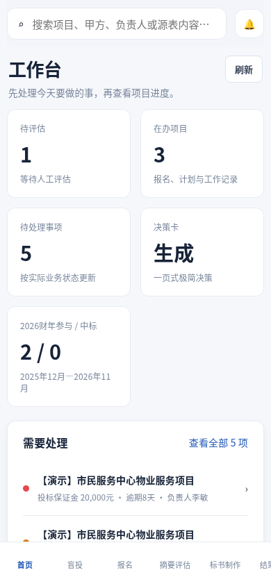

# BidOS UX fixes — 2026-11-11

This change preserves the existing sync-lock fix and repairs draft recovery, task completion, navigation and failure feedback. The comparison baseline is `f9016d3`.

| Finding | Result |
| --- | --- |
| B01 — unsaved edits | Work notes, materials, evaluation, blind-project and refund drafts survive the covered project, route and reload flows. Explicit discard clears a draft. Failed session-storage writes retain native unload protection until every unpersisted draft is saved or discarded. |
| B02 — filtered selection | The editor follows the filtered project list. Empty results hide the editor while preserving drafts. Historical links open their target and explain the history toggle. |
| B03 — follow-up completion | “完成本次跟进” clears the work reminder and records the completed action and time in notes. Another follow-up can be scheduled; bond reminders retain their own business workflow. |
| B04 — drawers | Blind-project and bond drawers share initial focus, Tab containment, background inertness, Escape handling and focus restoration. Dirty-close confirmation protects edits. |
| B05 — read recovery | Initial failure, loading, successful empty data and stale snapshots have distinct feedback. Read-only retry recovers without requiring a write/sync action. |
| B06 — mobile navigation | “更多” exposes data/automation, alerts and search. Automation is reachable in two clicks; returning from diagnostics retains blind filters. |
| B07 — task visibility | Three compact summary cards keep tasks higher on the page. The covered 390×844 viewport shows two complete tasks with dates and action links. |

Two additional save races were reproduced with failing assertions before their fixes. Concurrent note edits during a pending completion now retain both the new notes and the completion history. A delayed blind-project save response containing an older whole-workspace snapshot now reads the current snapshot instead of overwriting a newer save to another project. The six work/material race scenarios remain covered.

## Mobile comparison

Both images use a 390×844 viewport and the same reset synthetic fixture. The baseline frontend runs at loopback port 7523; the fixed frontend runs at 7521. Both proxy only to the isolated fixture at 7522.

| Before — `f9016d3` | After — this change |
| --- | --- |
|  |  |

### Comparison proof

Both captures were taken on 2026-11-11 in fresh Chromium contexts with locale `zh-CN`, mobile/touch enabled and no scrolling. Before each capture, the fixture was reset with `{ "reset": true, "mode": "normal", "delay": 0, "syncFail": false }`. The fixture's fixed business date is 2026-11-09. Both proxied workspace responses had fixture identity `ux-synthetic` and the identical SHA-256 below; task records and displayed task order also matched.

```text
workspace SHA-256: cc4d336bd50a3adcbbe7fa3586205ba2aba0701c3658c76e905559a8c81d1dc0
ordered task IDs: t-b1, w-p1, w-p2, w-p3, a-p3
```

| Geometry in CSS pixels | Before | After |
| --- | ---: | ---: |
| Summary cards / rows | 5 / 3 | 3 / 1 |
| Summary area bottom | 586 | 243 |
| Task panel top | 606 | 259 |
| First task bottom | 742.83 | 416.78 |
| Second task bottom | 820.66 | 537.95 |
| Fixed navigation top | 780 | 780 |

The baseline's second task extends beneath the fixed navigation. After the change, both tasks fit above it with their date and action links visible. Neither capture had horizontal overflow, a framework overlay or a JavaScript page error. The PNGs are approximately 55 KiB before and 67 KiB after. Baseline frontend source files were unchanged; an external Vite configuration supplied only the loopback fixture proxy and shared existing runtime dependencies.

## Validation

| Check | Result |
| --- | --- |
| Main browser UX suite | 17 scenario groups passed |
| Work/material save races | 6 scenario groups passed |
| Drawer route/draft scenarios | 4 scenario groups passed |
| Failed-storage unload protection | 1 scenario group passed |
| Historical project links | 1 scenario group passed |
| Frontend production build | `tsc -b && vite build` passed; 71 modules transformed |
| Sync-lock regression | 6 tests passed in 0.94s |

The 29 browser scenario groups exercise the real React frontend against in-memory synthetic HTTP responses. Desktop checks use 1440×900; mobile checks use 390×844. The main suite recorded no JavaScript page errors, framework overlay or missing-resource 404s. Its captured 409/503 resource errors were deliberately injected conflict/failure responses. Existing Playwright and Chromium were used because no Browser control tool was callable in this environment.

### Reproduce

Run from the repository root with the frontend's locked dependencies installed. Provide paths to an existing Playwright module and Chromium executable. See the [frontend test instructions](../../../tests/frontend/README.md) for coverage and temporary evidence locations.

Start these servers in separate terminals:

```sh
node tests/frontend/fixture-server.cjs
node apps/web/node_modules/vite/bin/vite.js --config tests/frontend/vite.fixture.config.mjs --configLoader native
```

Run the browser scripts serially:

```sh
export PLAYWRIGHT_MODULE=/path/to/playwright
export CHROMIUM_PATH=/path/to/chromium
node tests/frontend/ux-regression.cjs
node tests/frontend/draft-save-races.cjs
node tests/frontend/draft-storage-failure.cjs
node tests/frontend/historical-project-links.cjs
node tests/frontend/drawer-route-drafts.cjs
```

Build and run the targeted lock regression with the project Python test environment active:

```sh
npm --prefix apps/web run build
python -m pytest tests/backend/test_blind_sync_lock.py -q
```

Stop both test servers after validation. The fixture and frontend test configuration bind to loopback and do not import or start the real API or its schedulers. Each browser script checks fixture identity before mutations. Runtime screenshots, JSON results and request logs default to the system temporary directory; only the two intentionally published comparison images are included here.

## Business limits

These results do not validate real Excel writes, NAS availability, production database persistence, real account permissions, financial receipt or live collection. The lock regression uses temporary files and mocked business dependencies; it checks the real file lease through write and state-commit paths without opening a real workbook or database.

An earlier full backend-suite run reported 14 baseline failures. That suite is not claimed green; the backend result above is limited to the six targeted sync-lock tests.
